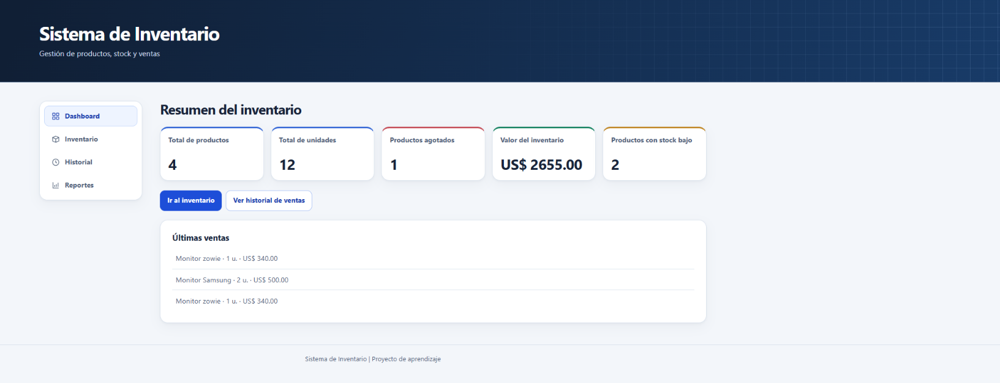

# Sistema de Inventario y Ventas

Aplicación web para gestionar productos y registrar ventas. Cada venta descuenta unidades del inventario y actualiza el resumen, el historial y los reportes. El historial se puede exportar a CSV completo o con los filtros que estén aplicados.

## Qué podés hacer

| Pantalla | Funcionalidades |
| --- | --- |
| Dashboard | Consultar productos, unidades, agotados, stock bajo, valor del inventario y últimas ventas. |
| Inventario | Agregar, editar y eliminar productos. Buscar, filtrar por stock, ordenar y registrar ventas. |
| Historial | Buscar ventas por producto, filtrar por fecha, ordenar las operaciones y descargar el historial completo o los resultados en CSV. |
| Reportes | Comparar productos por unidades vendidas o ingresos e identificar cuál lidera en ingresos. |

## Cómo probarlo

1. Abrí la carpeta del proyecto en VS Code.
2. Iniciá `index.html` con Live Server o serví la carpeta con un servidor estático de tu elección. No necesitás instalar paquetes ni configurar una base de datos.
3. En **Inventario**, agregá un producto de prueba con precio de **US$ 100** y stock inicial de **5**.
4. Vendé **2 unidades**. El stock debería bajar a **3** y la operación debería aparecer por **US$ 200** en **Historial** y en las últimas ventas del **Dashboard**.
5. Buscá el producto de prueba en **Historial** y elegí **Descargar resultados** para exportar las coincidencias.

## Tecnologías y almacenamiento

Proyecto desarrollado con **HTML, CSS y JavaScript**, sin framework ni backend. Los productos y las ventas se guardan en `localStorage` del navegador. Se conservan al recargar en el mismo navegador y la misma dirección, pero no se sincronizan entre dispositivos.

## Autor

Alejo García
